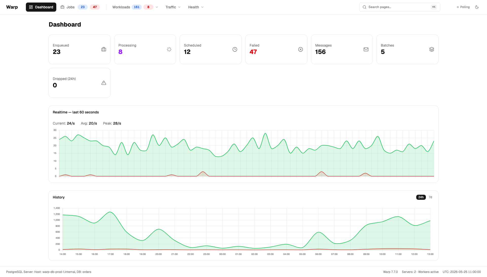

# Warp

**Background jobs, pub/sub messages and an in-process mediator for .NET 10, stored in the PostgreSQL or SQL Server database you already have.**

[](https://www.nuget.org/packages/Moberg.Warp.Core)
[](https://www.nuget.org/packages/Moberg.Warp.Core)
[](https://github.com/moberghr/warp/actions/workflows/test.yml)
[](LICENSE)
[](https://moberghr.github.io/warp/)

[Documentation](https://moberghr.github.io/warp/) · [Getting started](https://moberghr.github.io/warp/docs/getting-started) · [Performance](https://moberghr.github.io/warp/docs/performance) · [Release notes](https://moberghr.github.io/warp/docs/releases)

## Why Warp

- **One library, four kinds of work.** Jobs, messages, requests and streams share one handler model and one pipeline.
- **Jobs commit with your data.** Warp writes to your EF Core `DbContext`, so a job and the row it belongs to are saved together or not at all. There is no broker to run.
- **Light on the database.** In dispatcher mode jobs are claimed in batches and completed in batches: about 0.22 statements per job.
- **A dashboard that explains what happened.** State history, live handler logs, error groups, queue wait, SLOs and traces across jobs.
- **Nothing to register.** A source generator finds your handlers at build time and dispatches to them without reflection.

## Performance

The same 20,000 jobs on the same PostgreSQL server, 1 server × 10 workers, Warp 8.0 against Hangfire 1.8 (median of 3 runs):

| | Warp (dispatcher) | Warp (default) | Hangfire |
|---|---|---|---|
| Drain 20,000 empty jobs | **2.1 s** | 11.2 s | 34.7 s |
| Drain 20,000 jobs that read and update a row | **5.3 s** | 13.8 s | 36.4 s |
| Database statements per empty job | **0.22** | 7.03 | 40.03 |
| Database time per empty job | **0.061 ms** | 0.726 ms | 3.444 ms |
| Memory allocated per empty job | **15.2 KB** | 130.2 KB | 75.0 KB |

The harness is in [`src/benchmarks/Warp.Comparison`](src/benchmarks/Warp.Comparison) and runs in the Comparison workflow. Setup, every measured row and the caveats are on the [comparison page](https://moberghr.github.io/warp/docs/performance/warp-vs-hangfire).

## Quick start

```bash
dotnet add package Moberg.Warp.Core
dotnet add package Moberg.Warp.Worker
dotnet add package Moberg.Warp.Provider.PostgreSql   # or Moberg.Warp.Provider.SqlServer
dotnet add package Moberg.Warp.Dashboard
```

```csharp
builder.Services.AddDbContext<AppDbContext>(o => o.UseNpgsql(connectionString));

builder.Services.AddWarpServer<AppDbContext>(opt =>
{
    opt.UsePostgreSql();      // or opt.UseSqlServer()
    opt.AddRetry(r => r.MaxRetries = 3);
});

var app = builder.Build();
app.MapWarpDashboard("/warp");
app.Run();
```

Warp adds its tables to your `DbContext` model, in the `warp` schema. Create them with your normal migrations:

```bash
dotnet ef migrations add AddWarp
dotnet ef database update
```

A job commits in the same transaction as your data:

```csharp
// The job commits in the same transaction as the order.
db.Orders.Add(order);
await publisher.Enqueue(new SendConfirmationEmail { OrderId = order.Id });
await db.SaveChangesAsync();

public class SendConfirmationEmailHandler(IEmailSender email) : IJobHandler<SendConfirmationEmail>
{
    public Task HandleAsync(SendConfirmationEmail job, CancellationToken ct) =>
        email.SendConfirmation(job.OrderId, ct);
}
```

Use `AddWarp` in place of `AddWarpServer` in a process that only publishes. The [getting started guide](https://moberghr.github.io/warp/docs/getting-started) covers the rest.

## Four patterns

```csharp
// Job: one handler, durable, retried
await publisher.Enqueue(new GenerateReport { Month = 3 });
await publisher.Schedule(new GenerateReport { Month = 3 }, DateTime.UtcNow.AddHours(1));

// Message: every handler runs as its own job
await publisher.Publish(new OrderCreated { OrderId = order.Id });

// Request: in-process, typed response, no database
var user = await mediator.Send(new GetUser { UserId = 1 });

// Stream: in-process IAsyncEnumerable
await foreach (var item in mediator.CreateStream(new GetUsers { Role = "Admin" })) { }
```

| Pattern | Contract | Handler | Stored |
|---|---|---|---|
| [Jobs](https://moberghr.github.io/warp/docs/patterns/jobs) | `IJob` | `IJobHandler<T>` | Yes |
| [Messages](https://moberghr.github.io/warp/docs/patterns/messages) | `IMessage` | `IMessageHandler<T>`, any number | Yes |
| [Requests](https://moberghr.github.io/warp/docs/patterns/requests) | `IRequest<TResponse>` | `IRequestHandler<T, TResponse>` | No |
| [Streams](https://moberghr.github.io/warp/docs/patterns/requests#streams) | `IStreamRequest<TResponse>` | `IStreamRequestHandler<T, TResponse>` | No |

`IPipelineBehavior<T, TResponse>` wraps all four.

## Features

**Jobs and workflows**
[Transactional outbox](https://moberghr.github.io/warp/docs/features/outbox-pattern) ·
[Recurring jobs](https://moberghr.github.io/warp/docs/features/recurring-jobs) ·
[Batches and continuations](https://moberghr.github.io/warp/docs/patterns/jobs#batches) ·
[Named queues and worker groups](https://moberghr.github.io/warp/docs/operations/configuration#worker-groups) ·
[Sagas](https://moberghr.github.io/warp/docs/features/sagas) ·
[Background services](https://moberghr.github.io/warp/docs/features/background-services) ·
[Job metadata](https://moberghr.github.io/warp/docs/features/metadata) ·
[Cancellation](https://moberghr.github.io/warp/docs/features/cancellation) ·
[Pause and resume](https://moberghr.github.io/warp/docs/features/pause)

**Flow control**
[Retry](https://moberghr.github.io/warp/docs/patterns/jobs#retries) ·
[Mutex](https://moberghr.github.io/warp/docs/features/mutex) ·
[Semaphore](https://moberghr.github.io/warp/docs/features/semaphore) ·
[Rate limit](https://moberghr.github.io/warp/docs/features/rate-limit) ·
[Timeout](https://moberghr.github.io/warp/docs/features/timeout) ·
[Circuit breaker](https://moberghr.github.io/warp/docs/features/circuit-breaker) ·
[No-restart](https://moberghr.github.io/warp/docs/features/no-restart)

**Throughput and latency**
[Dispatcher mode and batched completions](https://moberghr.github.io/warp/docs/features/batched-completions) ·
[Database push](https://moberghr.github.io/warp/docs/features/db-push) (`LISTEN`/`NOTIFY`, Service Broker) ·
[Crash recovery](https://moberghr.github.io/warp/docs/operations/crash-recovery)

**HTTP and integrations**
[HTTP endpoints from handlers](https://moberghr.github.io/warp/docs/features/http) ·
[Outbound call adapters](https://moberghr.github.io/warp/docs/features/adapters) ·
[Durable webhooks](https://moberghr.github.io/warp/docs/features/webhooks)

**Observability**
[Dashboard](https://moberghr.github.io/warp/docs/dashboard/overview) ·
[Tracing across jobs](https://moberghr.github.io/warp/docs/features/tracing) ·
[Error grouping](https://moberghr.github.io/warp/docs/features/error-grouping) ·
[Queue wait and backlog](https://moberghr.github.io/warp/docs/features/queue-metrics) ·
[SLOs and error budgets](https://moberghr.github.io/warp/docs/features/slo-error-budget) ·
[Custom metrics](https://moberghr.github.io/warp/docs/features/custom-metrics) ·
[Operational notifications](https://moberghr.github.io/warp/docs/features/operational-notifications) ·
[Multi-application view](https://moberghr.github.io/warp/docs/features/applications)

## Dashboard

`app.MapWarpDashboard("/warp")` serves a dashboard with each job's state history, live handler logs, error groups, queue wait, SLOs and traces across jobs. See the [dashboard docs](https://moberghr.github.io/warp/docs/dashboard/overview).



## Packages

Use the same version for all of them.

| Package | Purpose |
|---|---|
| `Moberg.Warp.Core` | Publishing, the mediator, durable webhooks. Always required. |
| `Moberg.Warp.Worker` | The server: workers and background tasks. |
| `Moberg.Warp.Provider.PostgreSql` | PostgreSQL provider. |
| `Moberg.Warp.Provider.SqlServer` | SQL Server provider. |
| `Moberg.Warp.Dashboard` | The dashboard. |
| `Moberg.Warp.Http` | Expose request and stream handlers as HTTP endpoints. |
| `Moberg.Warp.Adapters.Http`, `Moberg.Warp.Adapters.Refit` | Observe and rate-limit outbound calls. |

Package ids are `Moberg.Warp.*`; namespaces are `Warp.*`.

## Coming from another library

- [Migrating from Hangfire](https://moberghr.github.io/warp/docs/operations/migrating-from-hangfire)
- [Migrating from Wolverine](https://moberghr.github.io/warp/docs/operations/migrating-from-wolverine)
- [When another tool fits better](https://moberghr.github.io/warp/docs/why-warp#when-another-tool-fits-better)

## Development

Requires the .NET 10 SDK, and Docker for the database tests.

```bash
dotnet build src/Warp.slnx
dotnet test --project src/tests/Warp.Tests/Warp.Tests.csproj                                      # all, about 5 minutes
dotnet test --project src/tests/Warp.Tests/Warp.Tests.csproj -- --filter-trait "Category=NoDb"    # no database
cd src/ui && npm install && npm run dev                                                           # dashboard on :5173
```

The source is under `src/core` (libraries and providers), `src/ui` (dashboard), `src/tests`, `src/benchmarks` and `src/demo`. The docs site is in `website/`.

## License

MIT. See [LICENSE](LICENSE).
